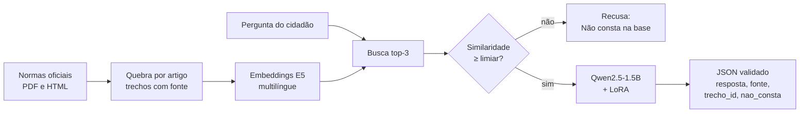

# Calçada Segura · Assistente de normas de calçada com LLM local

GS FIAP 2026.2 · CitizenTech · **Generative AI for Engineering** · Engenharia de Software 4ES

## 01 · Integrantes

| Nome completo | RM |
| --- | --- |
| Enzo Luiz Goulart | RM99666 |
| João Pedro Cruz | RM98650 |
| Tiago Paulino | RM55119 |
| Victor Eid | RM98668 |

## 02 · Ficha Técnica

| Campo | Valor |
| --- | --- |
| Produto | Calçada Segura |
| Cidadão e território | Pedestres de São Paulo, em especial idosos e pessoas com deficiência |
| Problema | Buracos, rampas fora da norma e barreiras nas calçadas não são fiscalizados, e o cidadão não sabe a regra nem quem deve consertar |
| O que a IA resolve | Responde perguntas sobre as regras de calçada de SP e de acessibilidade **citando a norma e o trecho**, e **recusa** quando a resposta não está na base |
| Modelo | Qwen2.5-1.5B-Instruct local + RAG (E5 multilíngue) + adaptador LoRA treinado pela equipe |
| Fontes | Decreto 59.671/2020, Lei 15.442/2011 (SP), Lei 13.146/2015 (LBI), Lei 10.098/2000 |
| Integração | `POST /perguntar` (pasta `api/`), chamado pelo dashboard do MVP |
| ODS | 11 (cidades sustentáveis), 10 (redução das desigualdades) |

## 03 · Pipeline de IA



Três configurações comparadas com as mesmas perguntas:

| Config | O que é |
| --- | --- |
| A · sem contexto | O modelo só com a pergunta |
| B · RAG simples | 3 trechos mais parecidos + limiar de recusa |
| C · RAG + LoRA | Igual à B, com o modelo especializado por LoRA |

**LoRA (especialização):** os dados de treino são sintéticos e não usam as perguntas de teste. Nos *positivos*, o modelo-base lê um trecho e escreve uma pergunta de cidadão e a resposta; só ficam os pares cuja resposta está apoiada no trecho. Nos *negativos*, perguntas fora do tema ensinam a recusar. Configuração: r=16, alpha=32, camadas q/k/v/o, 2 épocas.

## 04 · Base de conhecimento

*(preencher com `base/tabela_base.csv` depois de rodar o notebook)*

| Fonte | Formato | Licença | Trechos |
| --- | --- | --- | --- |
| Decreto Municipal 59.671/2020 | PDF | Texto oficial, sem direito autoral (Lei 9.610/98, art. 8º, IV) | ? |
| Lei Municipal 15.442/2011 | PDF | idem | ? |
| Lei 13.146/2015 (LBI) | HTML | idem | ? |
| Lei 10.098/2000 | HTML | idem | ? |

A NBR 9050 não entra na base por ser norma paga da ABNT. Perguntas sobre ela devem ser recusadas (caso de teste n08).

## 05 · Performance

*(preencher com os números do notebook)*

**Busca:** recall@1 = ? · recall@3 = ? · limiar = ?

| Config | Acurácia | Alucinação | Recusa correta | JSON válido | Tempo médio |
| --- | --- | --- | --- | --- | --- |
| A · sem contexto | ? | ? | ? | ? | ? |
| B · RAG simples | ? | ? | ? | ? | ? |
| C · RAG + LoRA | ? | ? | ? | ? | ? |

**Como medimos:** 38 perguntas (28 que constam e 10 que não constam). *Correta* = resposta com o termo esperado **e** citando a norma certa, ou recusa quando não consta. *Alucinação* = resposta errada ou sem a fonte certa, ou responder algo que não consta.

## 06 · Cinco erros reais

*(preencher a partir da seção 7 do notebook)*

| # | Pergunta | Resposta errada | Causa | Correção proposta |
| --- | --- | --- | --- | --- |
| 1 | | | | |
| 2 | | | | |
| 3 | | | | |
| 4 | | | | |
| 5 | | | | |

## 07 · Conclusão técnica

*(preencher depois do placar)*

## IA responsável e LGPD

- A IA só responde com base em normas oficiais e **cita o trecho**, para o cidadão poder conferir.
- Abaixo do limiar de similaridade, a IA **recusa** em vez de inventar.
- A resposta é orientação, não parecer jurídico. Decisões que afetam o cidadão, como multas e intimações, continuam com o agente público.
- A API não grava a pergunta nem dados de quem pergunta.

## Como reproduzir

1. Abra `notebooks/calcada_segura_ia.ipynb` no Google Colab, em Ambiente de execução → **T4 GPU**.
2. Ambiente de execução → **Executar tudo** (cerca de 40 min). O notebook clona este repositório, baixa as normas, monta a base, avalia, treina o LoRA e gera o placar.
3. Para a API: `pip install -r api/requirements.txt` e `uvicorn api.app:app --port 8001` (com `MODO=leve` funciona sem GPU).

```
ia/            código: base, busca, geração, avaliação e LoRA
base/          trechos.jsonl, tabela da base, embeddings e as fontes baixadas
avaliacao/     casos de teste, resultados, placar e gráficos
notebooks/     notebook com as saídas salvas
modelo/        adaptador LoRA treinado
api/           API FastAPI do assistente
```

## Links

- Repositório: https://github.com/Jpvalebm607/calcada-segura-ia
- Vídeo: (preencher)
