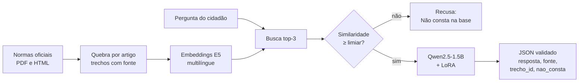
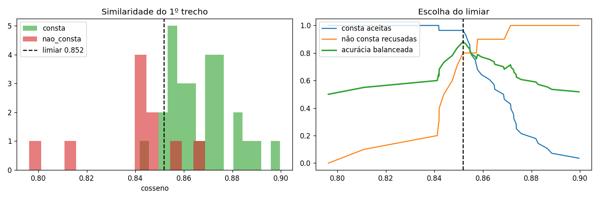
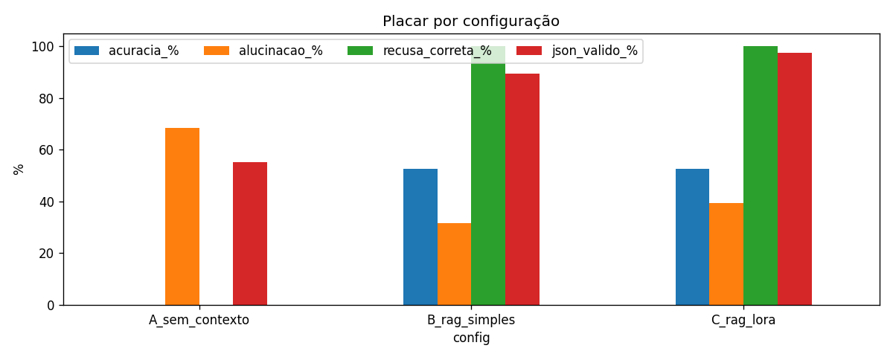

# Calçada Segura · Assistente de normas de calçada com LLM local

GS FIAP 2026.2 · CitizenTech · **Generative AI for Engineering** · Engenharia de Software 4ES

## 01 · Integrantes

| Nome completo | RM |
| --- | --- |
| Enzo Luiz Goulart | RM99666 |
| João Pedro Cruz | RM98650 |
| Tiago Paulino | RM55119 |
| Victor Eid | RM98668 |

## 02 · Ficha Técnica

| Campo | Valor |
| --- | --- |
| Produto | Calçada Segura |
| Cidadão e território | Pedestres de São Paulo, em especial idosos e pessoas com deficiência |
| Problema | Buracos, rampas fora da norma e barreiras nas calçadas não são fiscalizados, e o cidadão não sabe a regra nem quem deve consertar |
| O que a IA resolve | Responde perguntas sobre as regras de calçada de SP e de acessibilidade **citando a norma e o trecho**, e **recusa** quando a resposta não está na base |
| Modelo | Qwen2.5-1.5B-Instruct local + RAG (E5 multilíngue) + adaptador LoRA treinado pela equipe |
| Fontes | Decreto 59.671/2020, Lei 15.442/2011 (SP), Lei 13.146/2015 (LBI), Lei 10.098/2000 |
| Integração | `POST /perguntar` (pasta `api/`), chamado pelo dashboard do MVP |
| ODS | 11 (cidades sustentáveis), 10 (redução das desigualdades) |

## 03 · Pipeline de IA



Três configurações comparadas com as mesmas perguntas:

| Config | O que é |
| --- | --- |
| A · sem contexto | O modelo só com a pergunta |
| B · RAG simples | 3 trechos mais parecidos + limiar de recusa |
| C · RAG + LoRA | Igual à B, com o modelo especializado por LoRA |

**LoRA (especialização):** os dados de treino são sintéticos e não usam as perguntas de teste. Nos *positivos*, o modelo-base lê um trecho e escreve uma pergunta de cidadão e a resposta; só ficam os pares cuja resposta está apoiada no trecho. Nos *negativos*, perguntas fora do tema ensinam a recusar. Configuração: r=16, alpha=32, camadas q/k/v/o, 2 épocas.

## 04 · Base de conhecimento

**317 trechos** de 4 normas oficiais, quebradas por artigo (artigos longos viram partes de até 1.400 caracteres).

| Fonte | Formato | Licença | Trechos |
| --- | --- | --- | --- |
| Decreto Municipal 59.671/2020 (padronização das calçadas de SP) | PDF | Texto oficial de norma jurídica, sem direito autoral (Lei 9.610/1998, art. 8º, IV) | 57 |
| Lei Municipal 15.442/2011 (manutenção de passeios em SP) | PDF | idem | 27 |
| Lei 13.146/2015 (Lei Brasileira de Inclusão) | HTML | idem | 199 |
| Lei 10.098/2000 (acessibilidade) | HTML | idem | 34 |

O texto revogado (riscado no site do Planalto) fica de fora. A NBR 9050 não entra por ser norma paga da ABNT; perguntas sobre ela devem ser recusadas (caso n08). Os sites oficiais recusam conexões vindas do Colab, então as fontes foram baixadas no Brasil e enviadas para `base/fontes/`; o código usa esses arquivos se eles existirem.

## 05 · Performance

**Casos de teste:** 38 perguntas, 28 que constam e 10 que não constam (`avaliacao/casos_teste.json`).

**Busca** (E5 multilíngue, 317 trechos): **recall@1 = 55,6%** e **recall@3 = 81,5%**, sobre 27 perguntas. O caso c10 ficou sem trecho relevante no gabarito, porque o decreto não usa a expressão "encontro dos alinhamentos" prevista, e foi excluído do recall. O top-3 é o que vai para o modelo: em 8 de cada 10 perguntas, o trecho certo está no contexto.

**Limiar = 0,8518** (maior acurácia balanceada): aceita todas as perguntas que constam e recusa 8 das 10 que não constam antes de chamar o modelo. As outras 2 (preço do concreto e desconto no IPTU) o próprio modelo recusou.



| Config | Acurácia | Alucinação | Recusa correta | Recusa indevida | JSON válido | Cita a fonte certa | Tempo médio |
| --- | --- | --- | --- | --- | --- | --- | --- |
| A · sem contexto | 0,0% | 68,4% | 0% | 3,6% | 55,3% | 3,6% | 2,2 s |
| B · RAG simples | **52,6%** | **31,6%** | **100%** | 7,1% | 89,5% | 71,4% | 2,2 s |
| C · RAG + LoRA | **52,6%** | 39,5% | **100%** | 7,1% | **97,4%** | **75,0%** | 3,9 s |



**Como medimos:** *correta* = resposta com o termo esperado **e** citando a norma certa, ou recusa quando não consta. *Alucinação* = JSON válido com resposta errada ou sem a fonte certa, ou responder algo que não consta. JSON inválido conta à parte.

**Interpretação**

- **Contexto é o que mais pesa (A → B).** Sem contexto, o modelo não acerta nenhuma pergunta: quase nunca sabe o número do decreto (cita a fonte certa em 3,6% dos casos), inventa regras e responde tudo o que não consta. Com RAG e limiar, a acurácia vai de 0% para 52,6%, a alucinação cai de 68,4% para 31,6% e **todas as perguntas fora da base são recusadas**.
- **O LoRA ensinou o formato, não o conteúdo (B → C).** O JSON válido sobe de 89,5% para 97,4% e a citação da fonte certa de 71,4% para 75,0%, mas a acurácia fica igual. A alucinação sobe de 31,6% para 39,5% porque respostas que antes saíam em JSON inválido (e não contavam) passaram a sair válidas, porém erradas: o modelo ficou mais disciplinado, não mais sabido. Os dados de treino sintéticos (176 pares escritos pelo próprio modelo de 1,5B) ensinam bem a estrutura da resposta e a recusa, mas não acrescentam conhecimento.
- **O gargalo é a busca e o tamanho dos trechos.** Com recall@1 de 55,6%, em quase metade das perguntas o 1º trecho não é o certo, e o modelo de 1,5B tende a usar o 1º trecho. Artigos longos, com muitos incisos, também atrapalham.
- **Custo:** o adaptador LoRA não foi incorporado ao modelo, por isso o tempo sobe de 2,2 s para 3,9 s por resposta. Incorporar o adaptador (`merge_and_unload`) elimina esse custo.
- O LoRA convergiu bem: a perda caiu de 0,27 para cerca de 0,07 em 2 épocas (`avaliacao/perda_lora.png`).

## 06 · Cinco erros reais

| # | Pergunta | Resposta errada | Causa | Correção proposta |
| --- | --- | --- | --- | --- |
| 1 | c03 · Largura mínima da faixa de serviço? (esperado: 70 cm) | "A largura mínima da faixa de serviço é de 1,20 m" (B e C) | **Busca:** o trecho com os 70 cm (D59671-art4-2) não veio no top-3; veio a parte do mesmo artigo sobre a faixa livre, e o modelo trocou uma faixa pela outra | Quebrar os artigos por inciso, em vez de partes de 1.400 caracteres, para cada faixa ter seu trecho |
| 2 | c17 · Prazo para regularizar mobiliário irregular? (esperado: 20 dias) | "A Prefeitura pode realizar a reparação e remoção do mobiliário…" (B e C) | **Busca:** veio o artigo da remoção após 60 dias, e não o do prazo (L15442-art11); o modelo respondeu outra pergunta | Busca híbrida (BM25 + embeddings), para palavras exatas como "prazo" e "mobiliário" pesarem |
| 3 | c26 · O que são barreiras urbanísticas? | "Não consta na base" (B e C) | **Recusa indevida:** os trechos certos (L10098-art2-2 e LBI-art3-2) estavam no top-3, mas a definição fica no meio de uma lista longa de incisos e o modelo pequeno não a localizou | Trechos por inciso e um modelo maior (3B ou 7B) |
| 4 | c27 · Definição legal de acessibilidade? | "A acessibilidade é direito que garante à pessoa com deficiência… viver de forma independente" (B e C) | **Busca + modelo:** veio o art. 53 da LBI, que trata do *direito* à acessibilidade, e não o art. 3º, com a *definição*; o modelo respondeu com o trecho errado sem perceber a diferença | Reranker (cross-encoder) depois da busca, para reordenar o top-10 pela pergunta exata |
| 5 | c16 · Prazo para regularizar após intimação? (esperado: 30 dias, Lei 15.442) | "Trinta dias", citando o Decreto 59.671, art. 32 (C) | **Citação errada:** o conteúdo está certo, mas o modelo com LoRA citou o 1º trecho do contexto e não o que tinha a resposta (L15442-art11) | Verificação automática da citação: conferir se o trecho citado contém a resposta e, se não, trocar a citação ou recusar |

Outro caso parecido: em c02 (inclinação transversal de 3%), o trecho certo estava no top-3 e mesmo assim o modelo recusou, pelo mesmo motivo do erro 3.

## 07 · Conclusão técnica

A hipótese foi confirmada: **o mesmo modelo local de 1,5B passa de 0% para 52,6% de acurácia e reduz a alucinação pela metade quando recebe os trechos certos e um limiar de recusa**, e passa a recusar 100% das perguntas fora da base. Para um assistente público, recusar o que não sabe é tão importante quanto acertar.

O LoRA, treinado só com dados sintéticos e sem tocar nas perguntas de teste, deixou a saída mais confiável para integração (97,4% de JSON válido) e melhorou a citação, mas não a acurácia. Isso indica que, nesta escala, o próximo ganho não vem de treinar mais, e sim de **buscar melhor**: trechos por inciso, busca híbrida, reranker e verificação da citação. Com isso resolvido, vale testar um modelo de 3B a 7B.

**Limitações:** gabarito com 38 perguntas, escrito pela equipe (o caso c10 precisa de ajuste); o limiar foi escolhido nas próprias perguntas de teste, então em uso real ele deve ser recalibrado com perguntas novas; a Lei 15.442 está na versão original publicada, sem as alterações posteriores.

## IA responsável e LGPD

- A IA só responde com base em normas oficiais e **cita o trecho**, para o cidadão poder conferir.
- Abaixo do limiar de similaridade, a IA **recusa** em vez de inventar.
- A resposta é orientação, não parecer jurídico. Decisões que afetam o cidadão, como multas e intimações, continuam com o agente público.
- A API não grava a pergunta nem dados de quem pergunta.

## Como reproduzir

1. Abra `notebooks/calcada_segura_ia.ipynb` no Google Colab, em Ambiente de execução → **T4 GPU**.
2. Ambiente de execução → **Executar tudo** (cerca de 40 min). O notebook clona este repositório, baixa as normas, monta a base, avalia, treina o LoRA e gera o placar.
3. Para a API: `pip install -r api/requirements.txt` e `uvicorn api.app:app --port 8001` (com `MODO=leve` funciona sem GPU).

```
ia/            código: base, busca, geração, avaliação e LoRA
base/          trechos.jsonl, tabela da base, embeddings e as fontes baixadas
avaliacao/     casos de teste, resultados, placar e gráficos
notebooks/     notebook com as saídas salvas
modelo/        adaptador LoRA treinado
api/           API FastAPI do assistente
```

## Links

- Repositório: https://github.com/Jpvalebm607/calcada-segura-ia
- Vídeo: (preencher)
